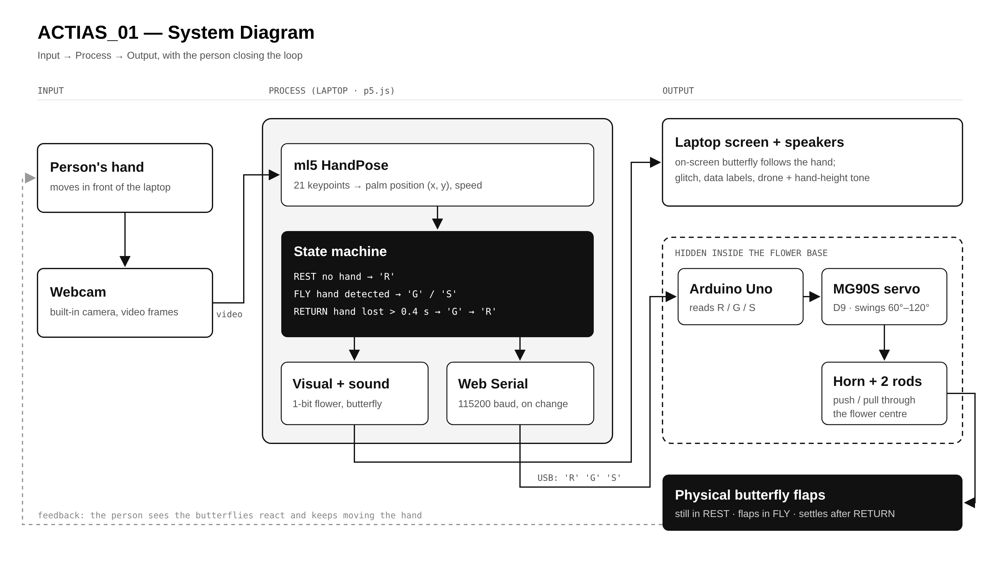
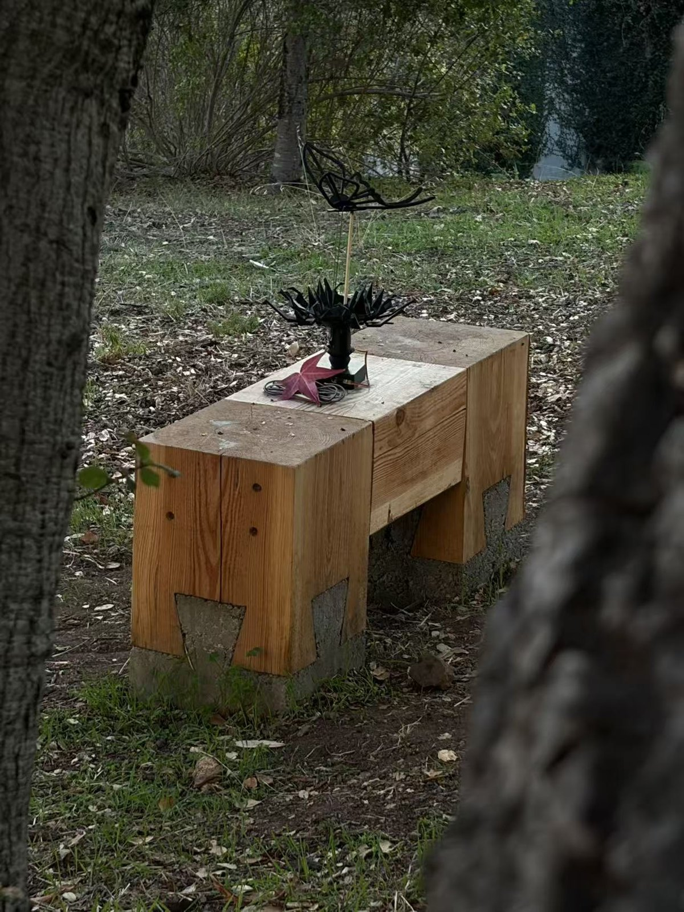
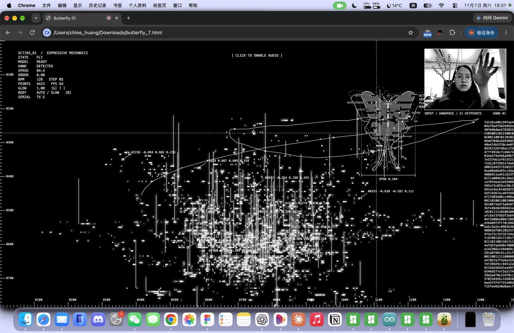
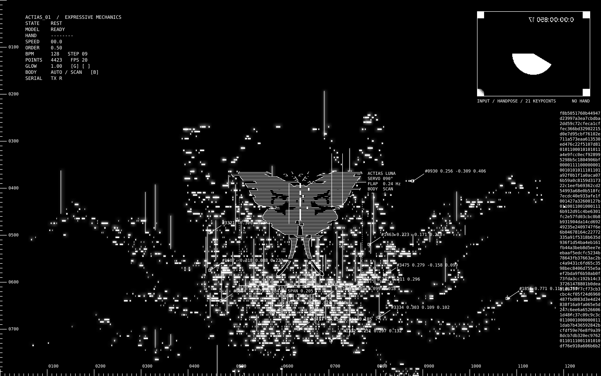
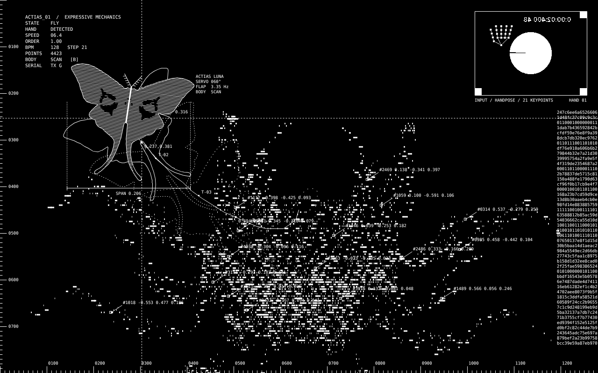
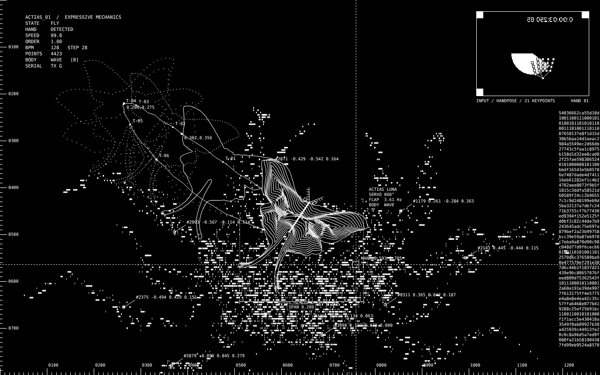
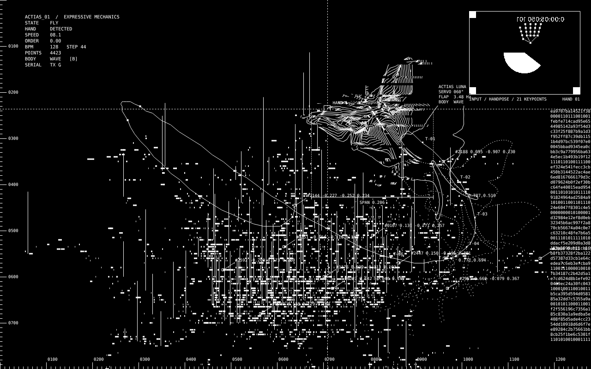

# mechanic-butterfly — ACTIAS_01

**Expressive Mechanics · TDF / Physical Computing**

A black mechanical butterfly rests on an abstract 3D-printed flower. When the laptop webcam sees a hand, the real butterfly starts to flap (Arduino + MG90S servo hidden in the flower base), and its digital twin on screen flies to follow the hand.

**▶ Live visual:** https://huanggedv.github.io/mechanic-butterfly/ — open in **Chrome** (Safari has no Web Serial).



| | |
|---|---|
|  |  |

---

## How it works

| State | Trigger | Screen | Physical butterfly | Serial |
|---|---|---|---|---|
| **REST** | no hand | butterfly sits on the flower | still (servo 90°) | `R` |
| **FLY** | hand detected | butterfly follows the palm | flaps | `G` / `S` (fast hand → fast flap) |
| **RETURN** | hand gone > 0.4 s | butterfly flies back | keeps flapping until it lands | `G` → `R` |

- Webcam → **ml5.js HandPose** (palm keypoint) → state machine in **p5.js**
- p5.js → **Web Serial** (115200 baud, sends a letter only when the state changes) → **Arduino Uno** → **MG90S** servo on D9
- Servo horn → 2 pushrods through the flower centre → wing hinges

## Repository

```
index.html          single-file build used by GitHub Pages
web/                source of the visual (p5.js)
  index.html  sketch.js  style.css
  flower_points.js  ← 4,423 points sampled from the Blender flower
  moth_shape.js     ← luna-moth contour lines + wing marks
arduino/
  butterfly_servo/        main sketch (180° MG90S)
  butterfly_servo_360/    fallback for a 360° continuous servo
models/
  blender/flower.blend    flower model (source of the point cloud)
  stl/01_small_fit        hinge ears, body, collar, fit coupon, servo cradle, horn adapter, eye sleeve
  stl/02_single_petal_trials
  stl/03_MG90S_enclosure_trial   vase lower / upper (servo + nut pockets)
  stl/04_optional_one_wing_trial
  stl/05_pushrods         printed adjustable pushrods (S: 140–195 mm, L: 200–275 mm)
  stl/extras              M3 big washer OD9 / ID3.4 / 1 mm
tools/
  sample_flower_points.py   Blender (bpy) → flower_points.js
  golden_hour_grade.py      video post-processing used for the golden-hour film
docs/
  design_journal.md, system diagram, photos, screen previews, films
```

## Run it

1. **Arduino** — open `arduino/butterfly_servo/butterfly_servo.ino` in Arduino IDE, select Arduino Uno + port, upload. **Close the Serial Monitor** afterwards (it blocks the port).
2. **Wiring** (no breadboard): servo brown → GND, red → 5V, orange → D9. If the board resets when the servo moves, power the servo from an external 5 V supply (shared GND).
3. **Visual** — open the live link (or `index.html`) in Chrome, allow the camera, click once to enable sound, press **C** and choose the Arduino port.

| Key | Action |
|---|---|
| click | enable sound |
| `C` | connect / disconnect Arduino |
| `F` | fullscreen |
| `V` | show / hide camera box |
| `M` | mute |
| `B` | butterfly style: AUTO · CONTOUR · SCAN · WAVE |
| `E` | stroboscopic echoes on / off |
| `X` | flip left–right direction |
| `G`, `[` `]` | glow on / off, weaker / stronger |

Tunable values sit at the top of `sketch.js` (`BPM`, `FOLLOW`, `FLIP_X`, `CAM_CONTRAST`, `GRAIN`, `GLOW` …) and of the Arduino sketch (`REST_ANGLE`, `SWING`).

## Hardware

- Arduino Uno, MG90S micro servo (180°), USB cable, laptop with webcam
- 5 mm wooden dowel (support rod), 0.8 mm steel wire / printed pushrods
- M2 × 16 + lock nuts (wing hinges) · M3 × 10–12 + nut (horn pivot) · M3 × 8–10 + nuts (cradle, base)
- Black PLA, Bambu Lab printer (11 plates, ~542 g, ~32 h for the full set)

## Visual design

1-bit black & white, inspired by Ryoji Ikeda (data, rhythm, glitch) and Zach Lieberman (gesture):
flower built from blinking barcode blocks with glow, BPM-synced order ↔ glitch cuts, invert strobe, coordinate labels, hex data stream, sound (drone, clicks, noise, hand-height tone), and a butterfly that switches between contour, scanline and sound-wave styles.

| Rest | Scanline | Sound-wave | Glitch |
|---|---|---|---|
|  |  |  |  |

## Films

- `docs/film/ACTIAS_01_one_minute.mp4` — 1-minute demo
- `docs/film/ACTIAS_01_golden_hour.mp4` — golden-hour graded version (post-processed render, not real footage)

## Credits

Built with [p5.js](https://p5js.org), [ml5.js](https://ml5js.org) HandPose and [p5.webserial](https://github.com/gohai/p5.webserial). Design, build and documentation by Huanggedv.
